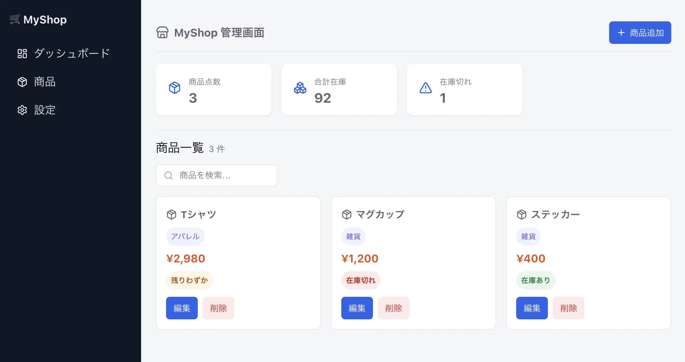

# ①課題名

ECサイト管理画面（静的サイト）

## ②課題内容（どんな作品か）

- ECショップの運営者・店舗担当者向けの管理画面ダッシュボードです。
- サイドバー（ダッシュボード・商品・設定）とヘッダーによる画面構成に加え、商品点数・合計在庫・在庫切れ件数を表示する統計カードを備えています。
- Reactの最初の学習プロジェクトとして、状態管理やAPI通信は行わず、静的サイトとして構築しています。

## ③アプリのデプロイURL

https://react-exp-0705-seven.vercel.app/

## ④アプリのログイン用IDまたはPassword（ある場合）

認証機能はありません

## ⑤工夫した点・こだわった点

- Sidebar・Header・StatCard・ProductCard・CategoryTag・PriceTag・StatusBadge・Buttonなど、画面の要素を小さい単位のコンポーネントに分割し、それぞれがpropsで受け取った値をmapで一覧表示しています。
- CSS Modulesを使い、コンポーネントごとにスタイルを閉じたスコープで管理することで、クラス名の衝突を防ぎました。

## ⑥難しかった点・次回トライしたいこと（又は機能）

今回が初めてのReactプロジェクトだったため、コンポーネント単位で考える設計やpropsでのデータの受け渡し方など、React特有の考え方に慣れること自体が難しかったです。React最初のプロジェクトとして以下を学びました。

- propsとmapを使ったデータ表示
- CSS Modulesでのスタイル適用
- ライブラリ（saas）の導入
- Vercelでのデプロイ

## ⑦フリー項目（感想、シェアしたいこと等なんでも）

今回はReactの最初のプロジェクトとして静的サイトでの構築になっていますが、次回はuseStateを使った状態管理（検索キーワードによる絞り込み、商品データの追加・編集・削除）や、API通信を取り入れた動的なサイトの構築にトライしたいです。
